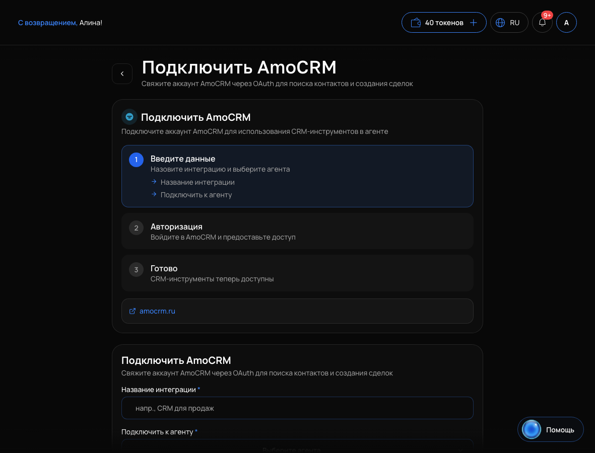
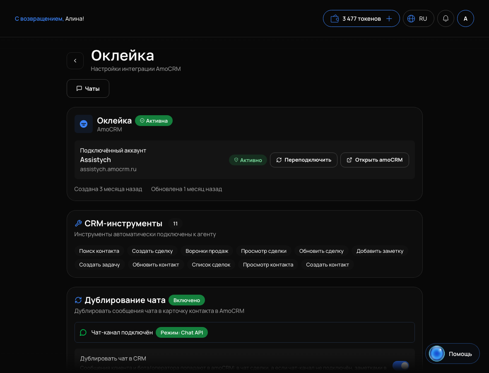
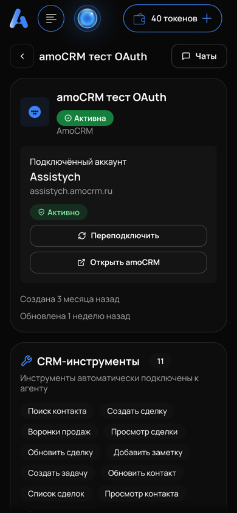
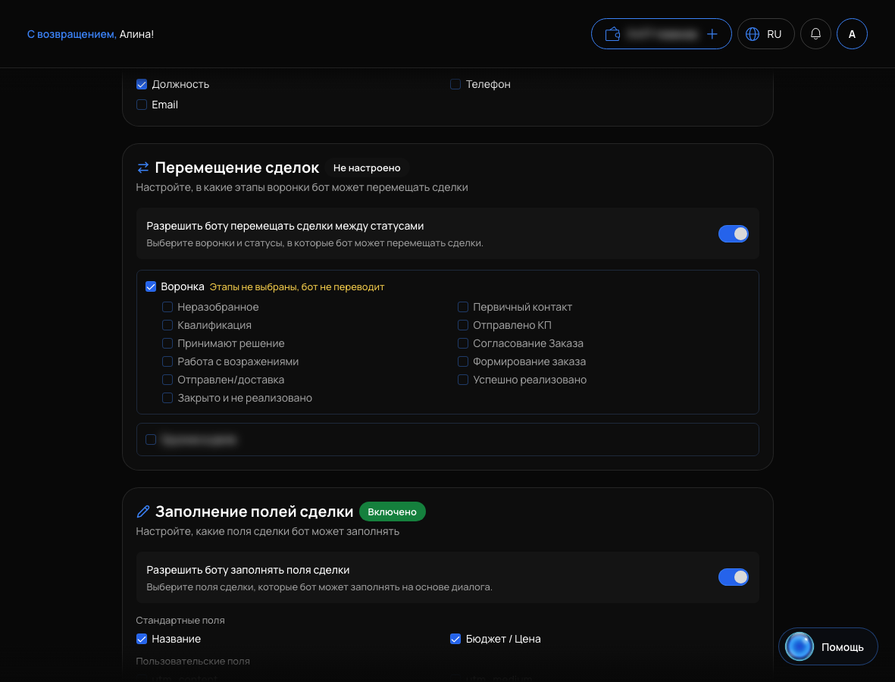

# amoCRM: установка из amoМаркета

Агент отвечает клиентам в ваших каналах (Авито, Telegram, ВКонтакте, MAX, сайт), а в amoCRM появляются заявка с контактом и вся переписка. Менеджер может ответить клиенту прямо из сделки.

## Что понадобится

* Тариф «Профи» или «Команда»: amoCRM входит в них.
* Аккаунт amoCRM, в котором вы можете устанавливать интеграции.
* Агент в Assistych, подключённый хотя бы к одному каналу.

## Установите из amoМаркета

1. В amoCRM откройте amoМаркет и найдите «Assistych».
2. Поставьте галочку «Согласен на передачу персональных данных…». Щёлкните по самому квадрату: подпись рядом — ссылка, она открывает политику.
3. Нажмите «Внешняя оплата». Так в amoМаркете называется кнопка установки: amoCRM входит в тариф Assistych, в amoCRM за неё не платят.
4. В карточке приложения появится текст «Интеграция установлена. Что дальше» со ссылкой «Откройте кабинет Assistych: https://assistych.ru/…». Перейдите по этой ссылке.
5. Войдите в кабинет Assistych или зарегистрируйтесь.
6. Подключите amoCRM к агенту, шаги ниже.


Установка в amoМаркете сама кабинет не связывает: связь появляется после шага «Подключить AmoCRM» в кабинете. Если вы начали из кабинета, amoМаркет можно пропустить.


## Подключите amoCRM к агенту

1. В кабинете откройте «Интеграции» и карточку amoCRM. Или «Агенты» → нужный агент → «Интеграции».
2. Заполните «Название интеграции», например «CRM продаж», и выберите агента в поле «Подключить к агенту».
3. Нажмите «Подключить AmoCRM».
4. В окне amoCRM выберите аккаунт и разрешите доступ.
5. Откроется страница интеграции со статусом «Активна».
6. В блоке «Дублирование чата» включите «Дублировать чат в CRM». После подключения он выключен, и пока он выключен, переписки в amoCRM нет.

## Что делает агент в amoCRM

* **Заявка, потом сделка.** Новый клиент написал в канал: в amoCRM появляется заявка в «Неразобранном» с контактом и чатом. Обычной сделкой в воронке она станет, когда менеджер нажмёт «Принять» или агент вызовет «Создать сделку». Агент делает это, только если так сказано в его инструкции: например, «когда клиент назвал услугу и время, создай сделку». На один диалог одна сделка, повторно агент её не заводит.
* **Переписка в сделке.** Блок «Дублирование чата», переключатель «Дублировать чат в CRM» (после подключения выключен): сообщения клиента, агента и менеджера попадают в чат сделки. Если чат-канал amoCRM недоступен, переписка пишется заметками в карточку контакта.
* **Действия по ходу разговора.** Блок «CRM-инструменты»: агент находит контакт, создаёт и обновляет сделку, ставит задачу менеджеру, добавляет заметку. Что именно делать, задаёте в инструкции агента.

## Ответ менеджера из сделки

Менеджер пишет в чат сделки в amoCRM. Клиент получает сообщение там, где писал. Проверено в Telegram и в виджете на сайте; Авито, ВКонтакте и MAX устроены так же, но живых ответов из amoCRM в них ещё не было: после первого такого ответа загляните в «Чаты», дошло ли. Вся переписка остаётся и в «Чатах» кабинета.

Чтобы агент не отвечал там, где ведёт менеджер, включите «Фильтр по воронке» и оставьте в нём только этапы, на которых работает агент.

## Настройки на странице интеграции

* **«Фильтр по воронке».** Агент отвечает только сделкам в выбранных воронках и этапах. Новым клиентам без записи в amoCRM агент отвечает всегда.
* **«CRM-контекст для бота».** Выбранные поля сделки и контакта агент видит, когда отвечает клиенту: например, бюджет, ответственного, телефон.
* **«Перемещение сделок».** Отметьте этапы, в которые агент может переводить сделку. Пока этапы не выбраны, агент сделки не двигает.
* **«Заполнение полей сделки»** и **«Заполнение полей контакта».** Отметьте поля, которые агент заполняет по разговору: название, бюджет, свои поля.

## Отключение

* **Временно, в amoCRM.** Отключите Assistych в amoМаркете. В кабинете интеграция получит статус «Нужно переподключить», агент перестанет писать в amoCRM. Настройки сохраняются. Вернуть: кнопка «Переподключить» на странице интеграции или снова установите Assistych в amoМаркете, интеграция включится сама с прежними настройками.
* **Насовсем, в кабинете.** Внизу страницы интеграции «Удалить интеграцию» и подтвердите. Интеграция удаляется вместе с настройками, переписка в «Чатах» остаётся. Подключить снова можно с нуля, шаги выше.

## Если что-то не так

* «amoCRM отключилась: переподключите её». Доступ истёк или его отозвали в amoCRM. Нажмите «Переподключить» вверху страницы интеграции.
* «Чат-канал недоступен». Переписка пишется заметками в контакт. Чтобы она шла в чат сделки, напишите в поддержку.
* Не загрузились воронки или поля. amoCRM не ответила, сохранённые настройки работают. Нажмите «Повторить» позже.
* В amoCRM нет переписки. Проверьте, что на странице интеграции включено «Дублировать чат в CRM».
* Сделки нет в воронке. Она ждёт в «Неразобранном»: нажмите «Принять» или добавьте в инструкцию агента, когда создавать сделку.
* Агент молчит у части клиентов. Проверьте «Фильтр по воронке»: агент отвечает только в отмеченных этапах.
* Не нашли Assistych в amoМаркете или установка не связалась с кабинетом. Подключите amoCRM из кабинета, шаги выше, или напишите в поддержку.
