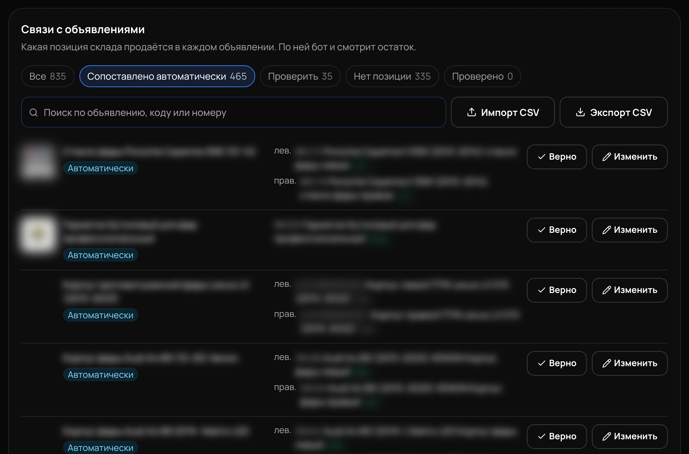
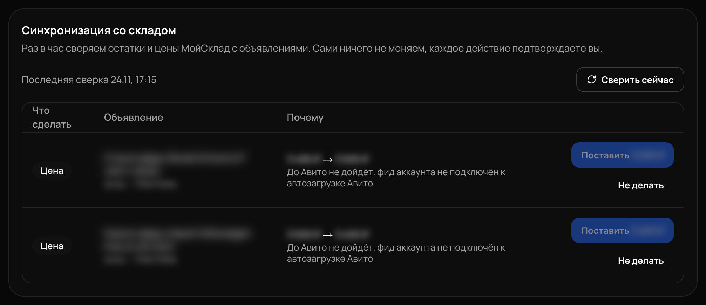
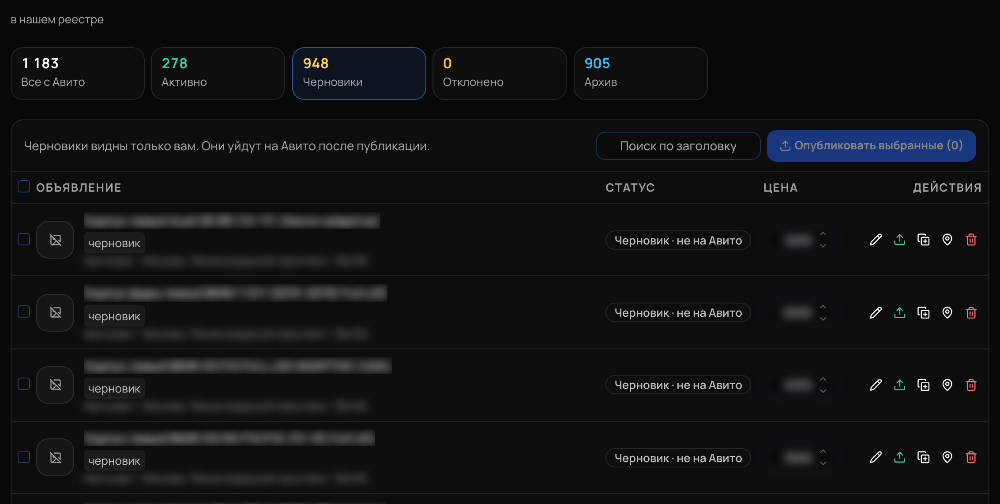
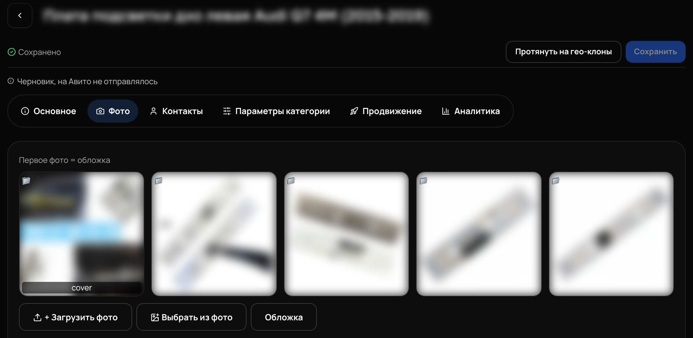
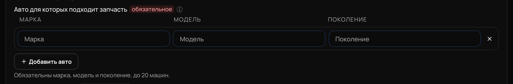
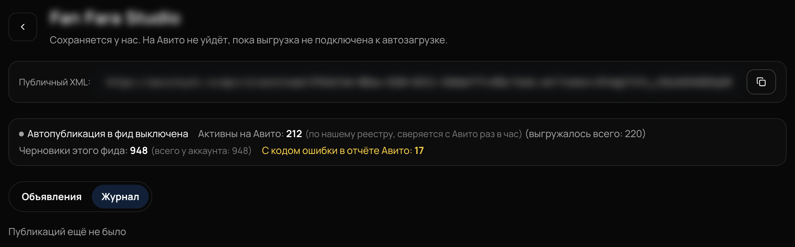

# МойСклад и Авито

Цены и остатки вы ведёте в МоёмСкладе, как привыкли. Assistych сверяет их с объявлениями на Авито:

* подсказывает, какое объявление снять, какое вернуть и где поправить цену;
* из новых позиций склада сам готовит черновики объявлений;
* подтягивает в них фото из папки на Яндекс Диске;
* выкладывает на Авито готовые объявления.

На складе мы ничего не меняем, только читаем.


Связи с объявлениями появляются, как только вы подключите МойСклад. Подсказки синхронизации, черновики из новых позиций, фото с Диска и выгрузку готовых мы включаем по вашей просьбе: напишите в поддержку. Переключателей для них в кабинете пока нет.


## Что понадобится

* МойСклад, подключённый в кабинете: «Интеграции» → «МойСклад», логин и пароль или токен. Хватит прав только на чтение.
* Аккаунт Авито в «Моих объявлениях» с выгрузкой (автозагрузкой).
* Для фото — общая папка на Яндекс Диске.

## Связи: какая позиция в каком объявлении

На странице МоегоСклада блок «Связи с объявлениями» показывает, какая позиция склада продаётся в каждом объявлении. По связи бот смотрит остаток, а синхронизация решает, что снять и какую цену поставить.

* **Статусы:**
  * «Автоматически» — пару сопоставили мы;
  * «Проверить» — подходящих позиций несколько, выберите сами;
  * «Проверено» — пару подтвердил человек;
  * «Нет позиции» — для объявления на складе ничего не нашлось.
* **«Верно»** подтверждает пару. **«Изменить»** открывает выбор: можно отметить одну или две позиции, например левое и правое стекло.
* **«Импорт CSV»** и **«Экспорт CSV»** — если удобнее проверить пары таблицей.
* **Пару, где цена склада совпала с ценой объявления (разница до 5 %),** мы подтверждаем сами. Непроверенную пару синхронизация не трогает.

## Синхронизация: что снять, что вернуть, где поправить цену

Блок «Синхронизация со складом» раз в час сверяет остатки и цены МоегоСклада с объявлениями. Сам он ничего не меняет: каждое действие подтверждаете вы кнопкой.

* **«Снять»** — объявление на Авито, а на складе ноль больше суток. У комплекта — когда нет ни левой, ни правой стороны. Кнопка «Снять с Авито» сначала покажет, кто писал по этому объявлению за последние 30 дней.
* **«Вернуть»** — объявление сняли по подсказке, а товар снова есть. Кнопка «Вернуть на Авито»: текст и фото вернутся прежние. Объявления, которые сняли вы сами или Авито, вернуть мы не предлагаем.
* **«Цена»** — цена на складе разошлась с ценой объявления, но не больше чем на 20 %. Кнопка «Поставить … ₽»: новая цена уйдёт на Авито со следующей выгрузкой. Цена комплекта — это левая сторона плюс правая.
* **«Проверить пару»** — расхождение больше 20 %. Скорее всего, пара объявление–позиция неверная: проверьте её в «Связях».
* **«Не делать»** — подсказка скроется и не появится, пока не изменится причина. Скрытые лежат в «Скрытые (N)», оттуда их можно вернуть кнопкой «Вернуть в список».


Снятое объявление на Авито возвращается только платно, по тарифу Авито. Поэтому снимаем мы его не сразу, а только если на складе ноль больше суток, и только после вашего подтверждения.


* **«Сверить сейчас»** запускает сверку, не дожидаясь часа. Время последней сверки показано рядом.
* **«До Авито не дойдёт»** под строкой и неактивная кнопка означают, что выгрузка этого аккаунта ещё не подключена к Авито. Причина написана тут же.
* **Если МойСклад не ответил или с него резко пропало много позиций,** сверка встаёт на паузу. Так случайная инвентаризация не снимет половину объявлений.
* **Блок «Расхождения цен»** ниже на той же странице показывает объявления, где цена склада отличается от цены на Авито больше чем на 5 %.

## Черновики из новых позиций

Раз в час мы смотрим, какие позиции МоегоСклада появились или вернулись в наличие, а объявления по ним ещё нет. По каждой такой позиции мы делаем черновик. Найти его можно в «Мои объявления» → нужный аккаунт → «Черновики».

* **Что в черновике:**
  * заголовок до 50 знаков и текст в том формате, который мы согласовали с вами;
  * цена из МоегоСклада (у комплекта это левая плюс правая);
  * для запчастей — машина, если по названию её удалось определить точно.

  Фото пока нет, вместо обложки значок.
* **Не больше 50 новых черновиков в сутки,** чтобы большая поставка не завалила список.
* **Если похожее объявление уже есть на Авито в любом вашем аккаунте,** черновик не создаём, чтобы не было дублей. Такие позиции мы присылаем вам списком «проверить».
* **Без цены на складе черновик не создаём.** Черновик, который вы удалили, сам не вернётся.

Текст, цену, фото и параметры черновика можно поправить самим: откройте карточку и нажмите «Сохранить». Цену, которую вы поправили руками, мы больше не трогаем.

## Фото с Яндекс Диска

1. Заведите на Яндекс Диске общую папку, а в ней по папке на каждую позицию. Назовите папку как позицию в МоёмСкладе или поставьте в начало имени код позиции.
2. Пришлите нам ссылку на общую папку. Поля для неё в кабинете пока нет.
3. Раз в час фото из папок попадают в черновики. Обложкой становится первое фото по имени файла.

* **Папку мы берём, когда её не меняли 30 минут:** значит, загрузка закончилась, и в черновик не попадёт половина фото.
* **Если папку не удалось сопоставить с позицией,** черновик не трогаем и присылаем вам список таких папок.

## Выгрузка готовых на Авито

Черновик считается готовым, когда у него есть:

* фото;
* цена и описание;
* все обязательные параметры (у запчастей это и машина);
* заголовок до 50 знаков;
* остаток на складе больше нуля.

Кроме того, карточку не должны были править последние 30 минут.

* **Раз в час мы выкладываем готовые черновики,** не больше 30 за раз. Сверх пакета Авито не публикуем: сколько объявлений выпускать в день, решаете вы.
* **Новый черновик выкладываем не раньше чем через час с небольшим после создания** и ещё раз сверяем его с живыми объявлениями. Если за это время появилось похожее, черновик ждёт вас.
* **Первую партию запускаем вместе с вами,** смотрим, как её примет Авито, дальше выгрузка идёт сама.
* **Чего не хватает до публикации, видно в карточке черновика:** обязательные поля помечены «обязательное», пустые подсвечиваются после «Сохранить».

Всё, что ушло на Авито, видно в журнале выгрузки: меню «Авито» → «Автозагрузка» → выгрузка аккаунта → вкладка «Журнал». Примерно через 3 часа там же появляется отчёт Авито по каждому объявлению.


Надпись «Автопубликация в фид выключена» на странице выгрузки относится к другой, старой настройке. Выгрузку готовых черновиков она не включает и не выключает.


## Кто что делает

| Кто | Что | Где |
|---|---|---|
| Вы | Цены и остатки | МойСклад |
| Вы | Фото в папки позиций | Яндекс Диск |
| Вы | Проверяете пары объявление–позиция | «Связи с объявлениями» |
| Вы | Подтверждаете снятие, возврат и цену | «Синхронизация со складом» |
| Вы | Правите текст, цену, фото, машину черновика | карточка черновика |
| Вы | Решаете, сколько объявлений выпускать в день и что первым | говорите нам |
| Assistych | Раз в час сверяет склад с объявлениями и даёт подсказки | автоматически, после включения |
| Assistych | Делает черновики новых позиций, кладёт фото, выкладывает готовые | автоматически, после включения |
| Поддержка | Включает черновики, фото и выгрузку, задаёт папку Диска и лимиты | по вашей просьбе |
| Поддержка | Присылает списки «проверить» и «папка не сопоставилась» | таблицей |

## Если что-то не так

* **Под подсказкой «До Авито не дойдёт».** Выгрузка аккаунта не подключена к профилю автозагрузки на Авито. Напишите в поддержку, подключим вместе.
* **Подсказки по объявлению нет.** Пара объявление–позиция не проверена: найдите объявление в «Связях» со статусом «Проверить» и нажмите «Верно» или «Изменить».
* **Черновик не уходит на Авито.** Откройте карточку и посмотрите, чего не хватает: фото, машины, цены. Ещё одна причина — на складе ноль.
* **Фото не появились.** Папка названа не так, как позиция в МоёмСкладе, или её меняли меньше 30 минут назад. Проверьте название или подождите час.
* **Сверка на паузе.** МойСклад не ответил или с него резко пропало много позиций. Когда склад ответит как обычно, сверка продолжится сама.
