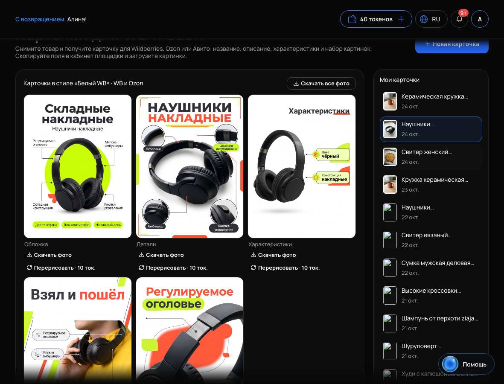
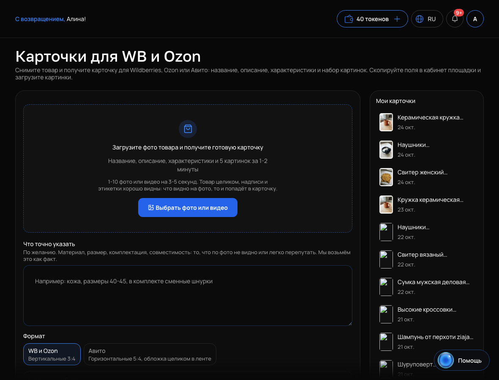
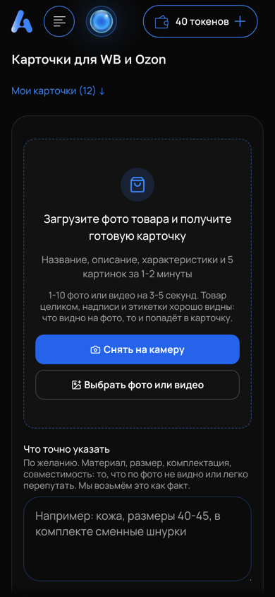
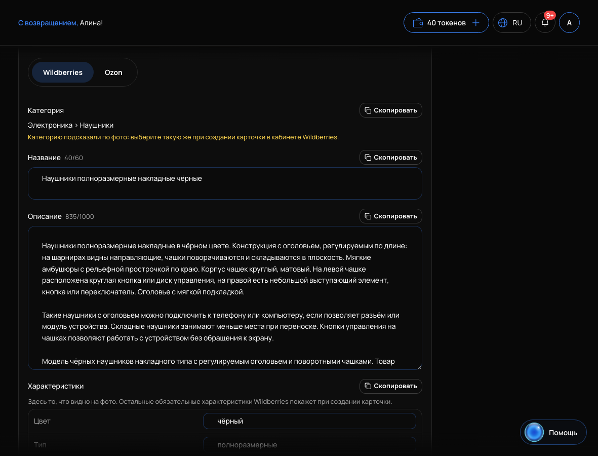
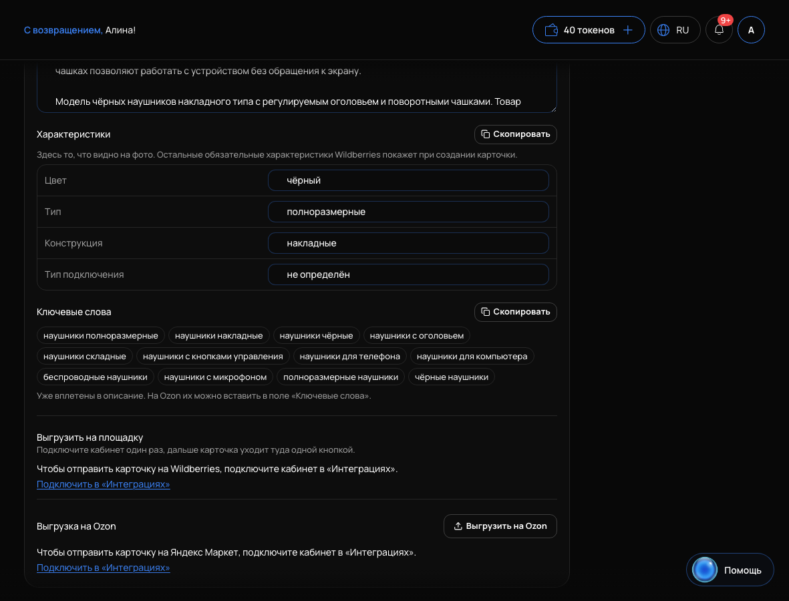
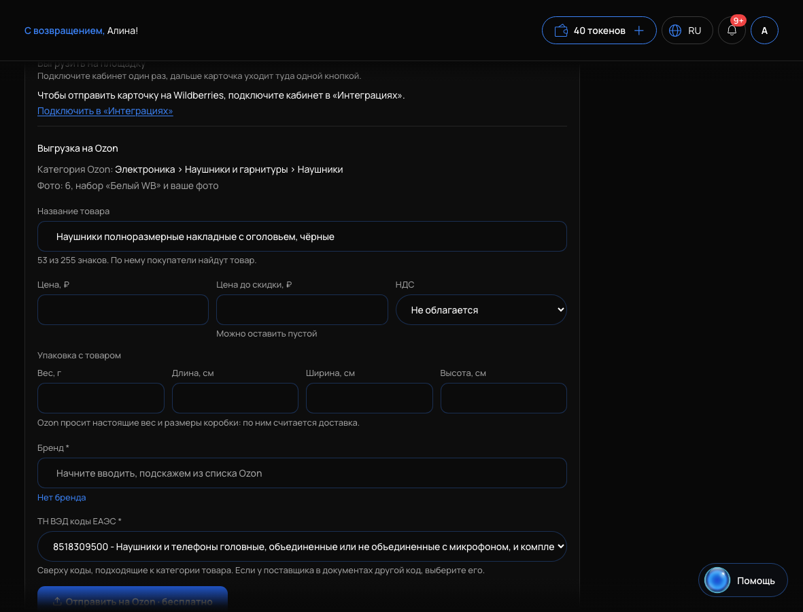

# Карточки для WB и Ozon

Снимите товар, и сервис сделает карточку: название, описание, характеристики, ключевые слова и набор картинок. Готовую карточку можно скопировать в кабинет площадки или выгрузить туда одной кнопкой.

Раздел в меню: «Карточки WB и Ozon».

## Что понадобится

* Фото товара, от 1 до 10, или видео от 3 до 5 секунд. Товар целиком, надписи и этикетки читаются: что видно на фото, то и попадёт в карточку.
* Токены на балансе. Тексты бесплатно, платите только за картинки. Цена видна на кнопке «Сделать карточку» до нажатия.

## Сделайте карточку

1. Откройте «Карточки WB и Ozon» и нажмите «Новая карточка».
2. Нажмите «Выбрать фото или видео». С телефона можно сразу «Снять на камеру».
3. Поле «Что точно указать» заполните, если по фото чего-то не видно: материал, размер, комплектация, совместимость. Это сервис возьмёт как факт.
4. «Формат»: «WB и Ozon» (вертикальные картинки 3:4) или «Авито» (горизонтальные 5:4).
5. Стиль картинок выберите сами или оставьте «Подберём сами»: стиль подберётся по товару.
6. «Картинок в наборе»: только обложка, несколько или все. Платите за то число, которое выбрали.
7. Нажмите «Сделать карточку». Тексты готовы примерно за минуту, картинки чуть дольше. Со страницы можно уйти: карточка появится в списке «Мои карточки».

С телефона то же самое: кнопка «Снять на камеру» сразу открывает камеру.

## Что в готовой карточке

Поля отдельные для каждой площадки: над ними переключатель «Wildberries» и «Ozon».

* «Категория»: подсказка по фото. Выберите такую же, когда создаёте карточку в кабинете площадки.
* «Название», «Описание», «Характеристики». Звёздочкой отмечены поля, обязательные для площадки: пустые заполните перед загрузкой.
* «Ключевые слова». Они уже вплетены в описание. На Ozon их можно вставить в поле «Ключевые слова».
* Набор картинок: обложка, детали крупно, характеристики, товар в деле, сцены. Кнопки «Скачать фото» под каждой и «Скачать все фото» над набором.

У каждого поля есть «Скопировать».

## Поправьте картинки

* «Тексты на картинках»: поменяйте заголовок, пункты или подписи и нажмите «Перерисовать». Каждая перерисовка платная, цена на кнопке. Чем короче текст, тем чище буквы на картинке.
* «Добавить ещё картинки» дорисует набор в том же стиле. Платите только за добавленные.
* «Прежние версии»: вернуть прошлую картинку можно бесплатно.

## Отправьте карточку на площадку

Есть два пути.

**Вручную.** Скопируйте поля кнопками «Скопировать», скачайте картинки и создайте карточку в кабинете площадки. Так можно у всех.

**Одной кнопкой: Wildberries, Ozon, Яндекс Маркет.** Под готовой карточкой блок «Выгрузить на площадку».


Выгрузка одной кнопкой пока включена не всем кабинетам. Если под карточкой нет блока «Выгрузить на площадку», пользуйтесь ручным путём или напишите в поддержку.


### Подключите кабинет площадки

Один раз для каждой площадки. Под карточкой нажмите «Подключить в «Интеграциях»».

**Wildberries**

1. Кабинет WB Партнёры: «Интеграции по API» → «Создать токен» → «Для интеграции вручную».
2. Тип «Базовый», категории «Контент» и «Цены и скидки», доступ «Чтение и запись».
3. Скопируйте токен сразу: его показывают один раз. Вставьте в поле «Токен WB» и нажмите «Проверить и подключить».

Персональный токен не подойдёт: WB запрещает передавать его другим сервисам. Токен WB действует 180 дней, потом его создают заново.

**Ozon**

1. Кабинет Ozon: «Настройки» → «API интеграции» → «Seller API».
2. «Сгенерировать ключ»: роли Product и Description Category (или Admin), название Assistych.
3. Скопируйте ключ сразу и Client-Id с той же страницы. Вставьте и нажмите «Проверить и подключить».

Ключ Ozon действует 90 дней. Перед концом срока сервис предупредит.

**Яндекс Маркет**

1. Кабинет продавца на Маркете: «Настройки» → «API и модули» → «Токены авторизации».
2. «Создать новый токен»: доступ «Управление товарами и карточками», название Assistych.
3. Скопируйте токен сразу и нажмите «Проверить и подключить».

### Выгрузите карточку

1. Под карточкой нажмите «Выгрузить на Ozon» (для WB и Маркета так же).
2. Проверьте форму. Категория и характеристики площадки подставлены из карточки. Укажите цену, НДС, вес и размеры упаковки: по ним площадка считает доставку.
3. Нажмите «Отправить на Ozon · бесплатно».
4. Статус появится под кнопкой. Ozon проверяет карточку обычно до суток, WB создаёт карточку до 30 минут, Маркет обновляет каталог за несколько минут. Страницу можно закрыть.
5. Товар появится в продаже, когда вы поставите остаток в кабинете площадки.

Нашли ошибку после выгрузки: поправьте карточку и нажмите «Выгрузить ещё раз». Площадка обновит тот же товар, второй не создаст.

## Чего раздел не делает

* Не отвечает покупателям на Wildberries и Ozon: агенты пока работают в Авито, Telegram, ВКонтакте, MAX и на сайте.
* Не ведёт остатки и заказы площадок: их ставите в кабинете площадки.

## Если что-то не так

* «Не получилось сделать карточку»: токены не списаны. Попробуйте ещё раз или другие фото.
* На картинке кривые буквы: сократите текст в «Тексты на картинках» и перерисуйте.
* «Ключу не хватает прав»: выпустите ключ Ozon с ролями Product и Description Category и подключите заново.
* «Токен WB больше не действует»: создайте новый токен в кабинете WB Партнёры.
* Ozon просит проверить вес и размеры: вес в граммах, размеры в сантиметрах.
* WB «Не отправим фото»: WB принимает фото не меньше 700×900.
* Нет блока «Выгрузить на площадку»: выгрузка в вашем кабинете ещё не включена, см. предупреждение выше.
