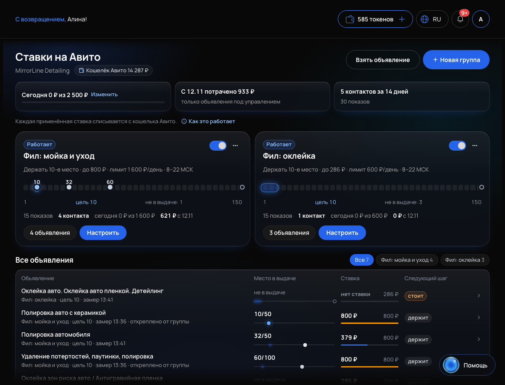
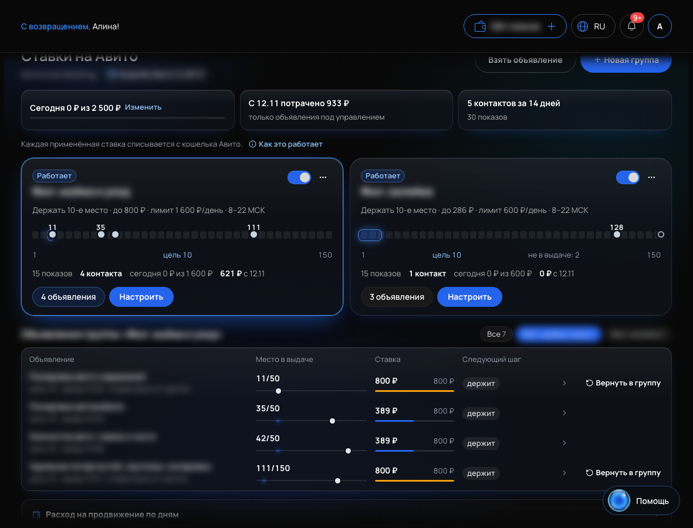
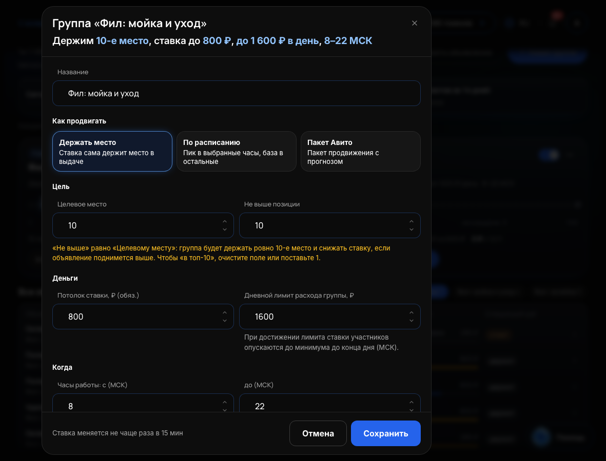
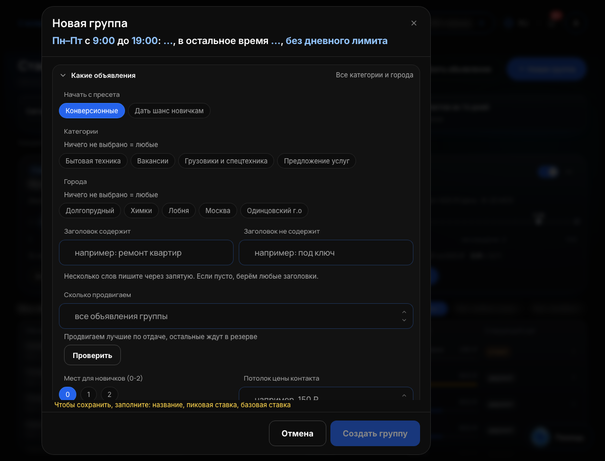
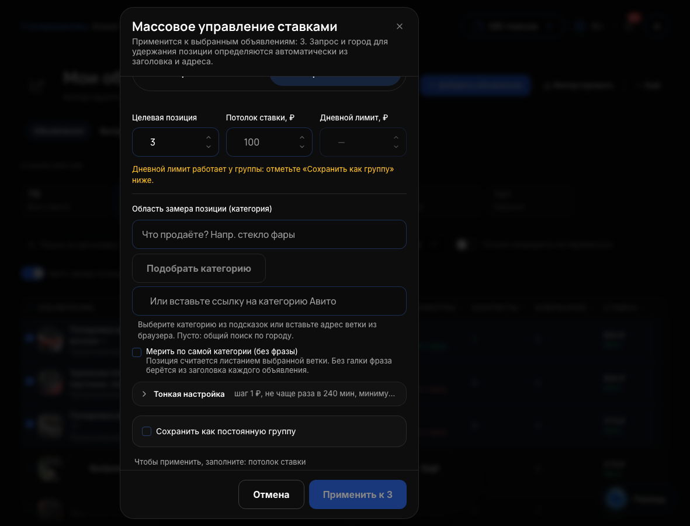
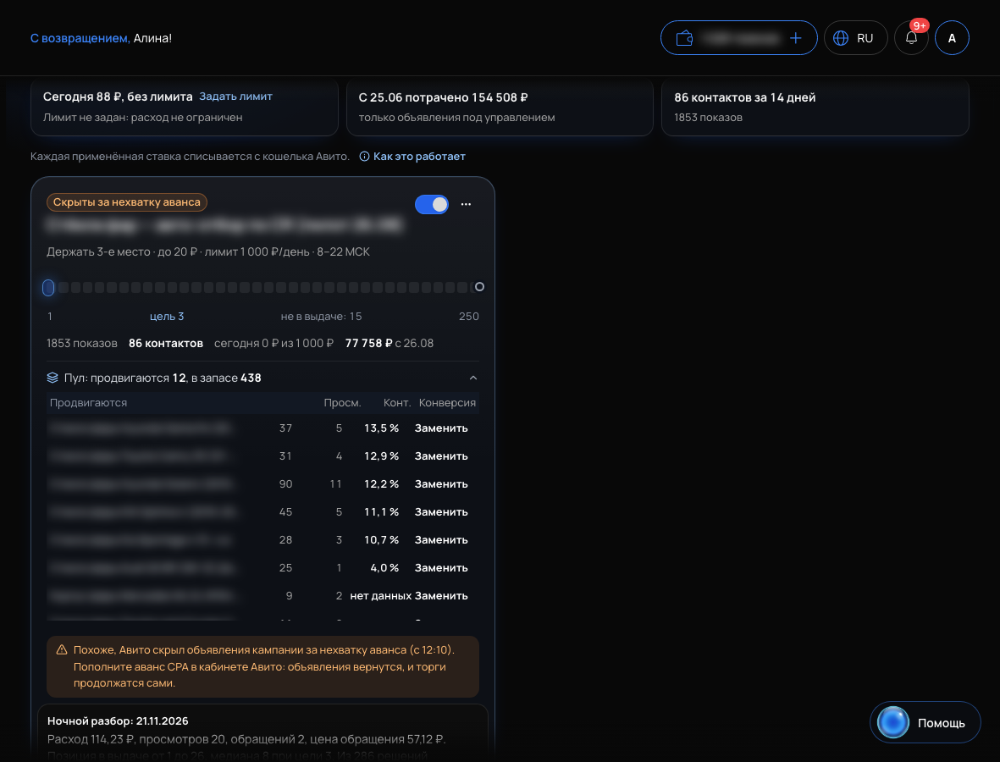
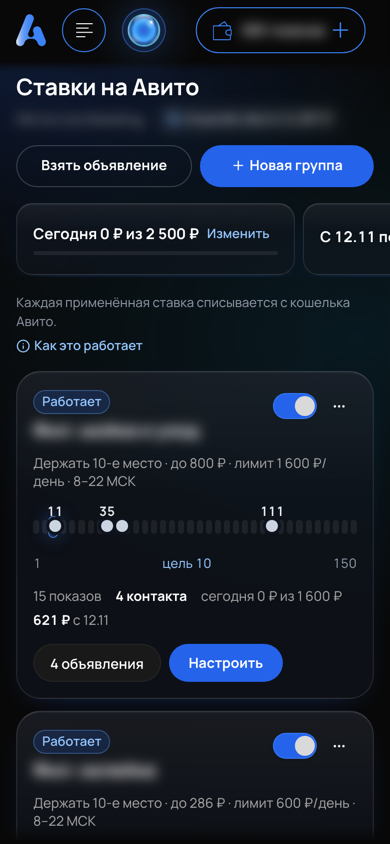

# Кампании ставок на Авито

Сервис сам двигает ставку за просмотры на Авито, чтобы объявления держались на нужном месте в выдаче и не тратили больше лимита. Объявления собираются в **кампании** (группы): у кампании одна цель, один потолок ставки и один лимит в день.

Раздел в меню: «Авито» → «Управление ставками». Если аккаунт Авито один, сразу откроется экран «Ставки на Авито».

## Что на экране

* **Шапка.** Аккаунт Авито и кошелёк Авито. Каждая применённая ставка списывается с кошелька Авито, не с баланса Assistych.
* **Итог.** «Сегодня 0 ₽ из 2 500 ₽»: сколько потрачено за день из общего лимита аккаунта. «Изменить» меняет лимит прямо здесь. Рядом: сколько потрачено с начала работы и контакты за 14 дней.
* **Карточки кампаний.** Статус («Работает», «Вне часов до 8:00», «Пауза»), название, стратегия одной строкой, лестница выдачи, показы, контакты, расход за день.
* **Лестница выдачи.** Шкала мест от 1 до конца выдачи. Точки: где сейчас стоят объявления кампании. Подсвеченная зона: цель. «Не в выдаче: 2»: объявления, которых при замере не нашли.
* **«Все объявления».** Список объявлений под управлением: место в выдаче, ставка к потолку, следующий шаг («поднимет до 229 ₽», «держит», «ждёт замера»). Нажмите на объявление: откроются его график, журнал ставок и настройки.

Нажмите на карточку кампании: список ниже покажет только её объявления. Нажмите ещё раз: снова все.

Пометка «откреплено от группы» у объявления значит, что его ставкой сейчас управляют отдельно, не правила кампании. Кнопка «Вернуть в группу» в списке кампании возвращает его.

## Создайте кампанию

1. Нажмите «Новая группа».
2. «Название», например «Мойка, Москва».
3. «Как продвигать»:
   * «Держать место»: ставка сама держит место в выдаче;
   * «По расписанию»: повышенная ставка в выбранные часы, базовая в остальные;
   * «Пакет Авито»: пакет продвижения с прогнозом.
4. Для «Держать место»:
   * **«Цель».** «Целевое место», например 10. Поле «Не выше позиции» оставьте пустым, если подходит любое место до 10-го: так дешевле, чем держать ровно 10-е.
   * **«Деньги».** «Потолок ставки» (обязательно): выше него ставка не поднимется никогда. «Дневной лимит расхода группы»: когда он исчерпан, ставки кампании опускаются до минимума до конца дня по Москве.
   * **«Когда».** «Часы работы» по Москве. Вне часов ставка опускается к минимуму. Пусто: круглосуточно. Окно через полночь можно, например с 22 до 8.
   * **«Где мерить место».** Ссылка на выдачу Авито. Место замеряется внутри неё, со всеми фильтрами из ссылки. Без ссылки фраза и город берутся по каждому объявлению.
5. «Какие объявления»: какие объявления войдут в кампанию, подробно ниже.
6. Нажмите «Создать группу» (у существующей кампании кнопка «Сохранить»). В шапке окна до сохранения видно итог одной фразой, например «Держим 10-е место, ставка до 800 ₽, до 1 600 ₽ в день».

«Тонкая настройка» (шаг ставки, как часто её менять, минимальная ставка) уже заполнена разумно. Менять её обычно не нужно.

## Как подтянуть объявления в кампанию

Три способа.

**1. Правилом: подходящие объявления подтягиваются сами.**

1. В окне кампании раскройте «Какие объявления».
2. Выберите «Категории» и «Города». Ничего не выбрано: подходят любые.
3. При необходимости заполните «Заголовок содержит» или «Заголовок не содержит»: слова через запятую.
4. Нажмите «Проверить»: покажет, сколько объявлений подойдёт.
5. Нажмите «Создать группу» или «Сохранить».

Новые объявления, которые подходят под правило, кампания подхватит сама при следующей синхронизации с Авито, она идёт раз в 4 часа.

**2. Из «Моих объявлений»: выбранные объявления одним списком.**

1. «Авито» → «Мои объявления». Отметьте нужные объявления галочками.
2. Внизу нажмите «Ставки».
3. Выберите «Держать место» и задайте место, потолок и лимит.
4. Отметьте «Сохранить как постоянную группу» и впишите название.
5. Нажмите «Применить к …» (число выбранных объявлений).

Получится кампания с фиксированным списком: в неё входят ровно эти объявления, новые сами не добавляются. В окне такой кампании в «Какие объявления» написано «Фиксированный список объявлений».

**3. Одно объявление отдельно.** Нажмите «Взять объявление», выберите объявление и задайте ему свою цель и потолок. Такие объявления видны в списке с фильтром «Без группы».

## Пул: продвигать лучшие

Если объявлений в кампании много, можно продвигать только лучшие по отдаче. В «Какие объявления» задайте «Сколько продвигаем», например 12.

На карточке кампании появится строка «Пул: продвигаются 12, в запасе 504». Нажмите на неё:

* «Продвигаются»: просмотры, контакты и конверсия каждого. «Заменить» снимает объявление из пула, его место займёт следующее по отдаче.
* «В запасе»: торги у них выключены. «Порог пула»: конверсия худшего из продвигаемых. Объявление из запаса вернётся в торги само, когда превысит её.

«Мест для новичков» даёт новым объявлениям без статистики неделю в торгах, не дожидаясь конверсии.

На телефоне тот же экран: карточки кампаний друг под другом, объявления списком ниже.

## Управляйте кампанией

* Переключатель на карточке: пауза и снова в работу.
* «Настроить»: то же окно, что при создании.
* «⋯» → «Динамика позиций»: график места и расхода.
* «⋯» → «Удалить группу»: ставки объявлений кампании выключаются, история ставок и трат остаётся.

## Деньги

* Ставки списываются с кошелька Авито. У Авито два счёта: основной кошелёк и аванс на продвижение. Какой тратится, видно по тому, какой убывает вместе с расходом.
* Пустой аванс: Авито может скрыть объявления из выдачи, на карточке будет «Скрыты за нехватку аванса». Пополните аванс в кабинете Авито, объявления вернутся сами.
* Общий лимит аккаунта в день: «Изменить» в итоге наверху экрана. Лимит кампании: «Дневной лимит расхода группы» в её окне.

## Если что-то не так

* **Ставка не меняется.** Откройте объявление и посмотрите журнал ставок: там причина. Частые: достигнут потолок, место уже в цели, ещё не прошло время до следующего шага (внизу окна кампании: «Ставка меняется не чаще раза в … мин»).
* **«Ждёт замера».** Место ещё не замерили после изменения. Замер идёт сам, обычно в течение нескольких минут.
* **«Не в выдаче».** Объявления нет в выдаче по ссылке или фразе. Проверьте «Где мерить место»: ссылка должна вести в ту категорию и город, где объявление показывается.
* **«Вне часов до 8:00».** Сейчас вне часов работы, ставки на минимуме. Так задумано.
* **Новые объявления не попадают в кампанию.** Правило проверяется раз в 4 часа. Если кампания с фиксированным списком, новые объявления добавьте способом 2 или 3.
* **Авито не даёт управлять ставками.** Аккаунт на оплате за звонки и чаты: ставок у него нет. Используйте [Продвижение с прогнозом](forecast.md).
